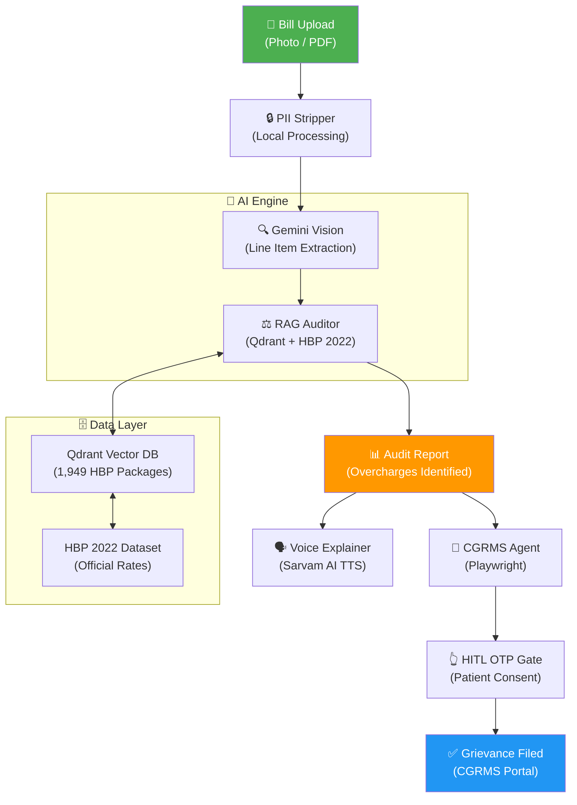

<p align="center">
  <h1 align="center">🛡️ Ayushman-Shield</h1>
  <p align="center">
    <strong>Autonomous PM-JAY Hospital Bill Auditor & CGRMS Grievance Agent</strong>
  </p>
  <p align="center">
    <em>Protecting 55 crore Indians from hospital overbilling — one bill at a time.</em>
  </p>
</p>

<p align="center">
  
  
  
  
  
  
</p>

---

## 📋 Table of Contents

- [Problem Statement](#-problem-statement)
- [Our Solution](#-our-solution)
- [Architecture](#-architecture)
- [Tech Stack](#-tech-stack)
- [Getting Started](#-getting-started)
- [API Documentation](#-api-documentation)
- [Screenshots](#-screenshots)
- [Team & Hackathon](#-team--hackathon)
- [License](#-license)

---

## 🚨 Problem Statement

**Pradhan Mantri Jan Arogya Yojana (PM-JAY)** is the world's largest government-funded health insurance scheme, covering **55 crore Indians** with up to **₹5 lakh per family per year** for secondary and tertiary hospitalizations.

Despite its scale, the scheme faces **critical challenges**:

| Problem | Impact |
|---|---|
| 🏥 **Hospital Overbilling** | Hospitals routinely charge patients for items that are already **bundled inside HBP packages** — implants, consumables, diagnostics |
| 🤷 **Patient Unawareness** | Most beneficiaries don't know what their package covers; they pay out-of-pocket for things that should be free |
| 📝 **Complex Grievance Filing** | The [CGRMS portal](https://cgrms.pmjay.gov.in) is difficult to navigate, especially for rural and non-English-speaking populations |
| 🔍 **Manual Auditing** | Currently, bill verification against 1,949 HBP 2022 packages requires manual cross-referencing — slow and error-prone |

> **The result:** Billions of rupees in fraudulent charges go unchallenged, and the most vulnerable citizens bear the cost.

---

## 💡 Our Solution

**Ayushman-Shield** is an **AI-powered autonomous bill auditor** that turns a hospital bill photo into actionable justice — in any Indian language.

### 🔄 The Pipeline

| Step | What Happens | Technology |
|:---:|---|---|
| 📸 **1** | Patient uploads a hospital bill (photo or PDF) | Next.js Frontend |
| 🔒 **2** | PII (name, Aadhaar, phone) is stripped **locally** before cloud processing | Regex + On-device masking |
| 🔍 **3** | Gemini Vision extracts line items, procedure codes, and charges | Gemini 2.5 Pro |
| ⚖️ **4** | Each line item is cross-audited against **HBP 2022 official rates** via RAG | Qdrant + Semantic Search |
| 📊 **5** | Detailed audit report generated with overcharge amounts and violations | LangGraph Agent |
| 🗣️ **6** | Voice explanation generated in **10+ Indian languages** | Sarvam AI TTS |
| 📝 **7** | CGRMS grievance auto-filed with **Human-in-the-Loop OTP gate** | Playwright + HITL |

### ✨ Key Features

- 🏷️ **Zero-cost for patients** — fully open-source
- 🌐 **10+ Indian languages** — Hindi, Tamil, Telugu, Bengali, Marathi, and more
- 🔐 **Privacy-first** — PII never leaves the device
- 🤖 **Fully autonomous** — from bill scan to grievance filing
- 👆 **Human-in-the-loop** — OTP verification ensures patient consent
- 📊 **Transparent auditing** — every overcharge is cited against official HBP rates

---

## 🏗️ Architecture



---

## 🛠️ Tech Stack

| Layer | Technology | Version | Purpose |
|---|---|---|---|
| **Frontend** | Next.js | 15 | React-based UI with App Router |
| **Frontend** | Tailwind CSS | 4 | Utility-first styling |
| **Frontend** | shadcn/ui | latest | Accessible component library |
| **Backend** | FastAPI | 0.115+ | High-performance async API |
| **Backend** | LangGraph | 0.4+ | Stateful AI agent orchestration |
| **AI** | Gemini 2.5 Pro | latest | Vision OCR + reasoning engine |
| **AI** | Sarvam AI | latest | Indic-language TTS |
| **Vector DB** | Qdrant | 1.13.2 | Semantic search over HBP packages |
| **Automation** | Playwright | latest | CGRMS portal interaction |
| **Infra** | Docker Compose | 3.8 | Container orchestration |
| **Language** | Python | 3.11+ | Backend runtime |
| **Language** | TypeScript | 5+ | Frontend runtime |

---

## 🚀 Getting Started

### Prerequisites

| Tool | Version | Install |
|---|---|---|
| **Node.js** | 18+ | [nodejs.org](https://nodejs.org) |
| **Python** | 3.11+ | [python.org](https://python.org) |
| **Docker** | 24+ | [docker.com](https://docker.com) |
| **Git** | 2.40+ | [git-scm.com](https://git-scm.com) |

### 1️⃣ Clone & Setup

```bash
git clone https://github.com/your-team/ayushman-shield.git
cd ayushman-shield
```

### 2️⃣ Configure Environment Variables

```bash
cp .env.example .env
```

Edit `.env` and add your API keys:

```env
GEMINI_API_KEY=your_gemini_api_key_here    # from https://aistudio.google.com/apikey
SARVAM_API_KEY=your_sarvam_api_key_here    # from https://console.sarvam.ai
```

### 3️⃣ Start Qdrant (Vector Database)

```bash
docker-compose up qdrant -d
```

Verify it's running at [http://localhost:6333/dashboard](http://localhost:6333/dashboard).

### 4️⃣ Ingest HBP 2022 Data

```bash
cd backend
python -m venv .venv
source .venv/bin/activate        # Windows: .venv\Scripts\activate
pip install -r requirements.txt
python -m app.scripts.ingest_hbp
```

This indexes all **1,949 HBP 2022 packages** into Qdrant for semantic search.

### 5️⃣ Start the Backend

```bash
uvicorn app.main:app --host 0.0.0.0 --port 8000 --reload
```

API docs available at [http://localhost:8000/docs](http://localhost:8000/docs).

### 6️⃣ Start the Frontend

```bash
cd frontend
npm install
npm run dev
```

### 7️⃣ Open in Browser

Navigate to [http://localhost:3000](http://localhost:3000) and upload your first bill! 🎉

### 🐳 Or Use Docker (Full Stack)

```bash
docker-compose up --build
```

This starts both Qdrant and the backend. Access the API at `http://localhost:8000`.

---

## 📡 API Documentation

### Core Endpoints

| Method | Endpoint | Description |
|---|---|---|
| `POST` | `/api/v1/audit/upload` | Upload a hospital bill (image/PDF) for auditing |
| `GET` | `/api/v1/audit/{audit_id}` | Get audit results by ID |
| `GET` | `/api/v1/audit/{audit_id}/report` | Download the detailed audit report (PDF) |
| `POST` | `/api/v1/audit/{audit_id}/voice` | Generate voice explanation in specified language |
| `GET` | `/api/v1/audit/{audit_id}/voice/{lang}` | Download generated voice file |

### CGRMS Grievance Endpoints

| Method | Endpoint | Description |
|---|---|---|
| `POST` | `/api/v1/grievance/initiate` | Start CGRMS grievance filing flow |
| `POST` | `/api/v1/grievance/verify-otp` | Submit OTP for HITL verification |
| `GET` | `/api/v1/grievance/{grievance_id}/status` | Check grievance filing status |

### Utility Endpoints

| Method | Endpoint | Description |
|---|---|---|
| `GET` | `/api/v1/packages/search` | Search HBP 2022 packages by name or code |
| `GET` | `/api/v1/packages/{package_code}` | Get details for a specific HBP package |
| `GET` | `/health` | Service health check |

> 📘 **Interactive API docs** are available at `/docs` (Swagger UI) and `/redoc` (ReDoc) when the backend is running.

---

## 📸 Screenshots

<p align="center">
  <em>Screenshots will be added after the UI is finalized.</em>
</p>

| Screen | Description |
|---|---|
| 🏠 Home | Landing page with bill upload |
| 📊 Audit Report | Detailed line-item audit results |
| 🗣️ Voice Explainer | Language selection and audio playback |
| 📝 Grievance Filing | CGRMS auto-fill with OTP gate |

---

## 👥 Team & Hackathon

<table>
  <tr>
    <td align="center">
      <strong>🏆 Forge Gen AI Buildathon 2026</strong><br/>
      <em>Theme: Civic Pulse — Digital Governance & Public Information</em>
    </td>
  </tr>
</table>

### 🎯 Why This Matters

- **55 crore** Indians are PM-JAY beneficiaries
- Hospital fraud costs the exchequer **thousands of crores** annually
- Most victims are from **economically weaker sections** who can't fight back
- **Language barriers** prevent access to grievance mechanisms

> *Ayushman-Shield gives every patient the power to audit their hospital bill and file a grievance — in their own language, in under 2 minutes.*

---

## 📄 License

This project is licensed under the **MIT License** — see the [LICENSE](LICENSE) file for details.

---

<p align="center">
  Built with ❤️ for India's healthcare transparency
  <br/>
  <strong>🛡️ Ayushman-Shield — Because every patient deserves a fair bill.</strong>
</p>
